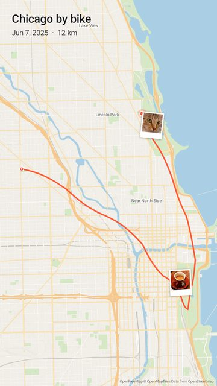
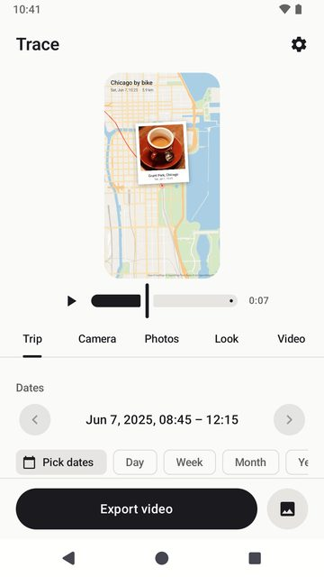
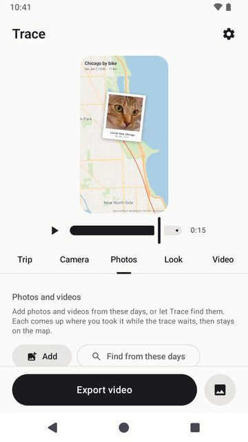

# Trace

Turn your Google Maps Timeline into a short, calm video of where you went. A line crosses the
map, the camera follows it, and your photos come up where you took them.

  
  
  

## How it works

1. Export your Timeline from Google Maps on your phone. Trace has a button that takes you to
   the right page.
2. Choose the days, down to the hour if you like.
3. Change the look while the preview plays, then save an MP4.

Android 8.0 or newer. Google Play listing: coming soon.

## Privacy

No accounts, no ads, no analytics, and no servers of its own. Your Timeline and photos stay on
your phone. Details in the [privacy policy](privacy/).

## По-русски

Trace превращает Хронологию Google Карт в короткое спокойное видео ваших поездок: линия ведёт по
карте, камера следует за ней, а фото появляются там, где были сняты. Без аккаунтов и рекламы,
Хронология и фото остаются на телефоне. [Политика конфиденциальности](privacy/#ru).

## Source

[github.com/Han-Soda/trace](https://github.com/Han-Soda/trace), MIT license. Trace grew out of
[Timeline Visualizer](https://github.com/mahlernim/google-timeline-visualizer) by mahlernim.
